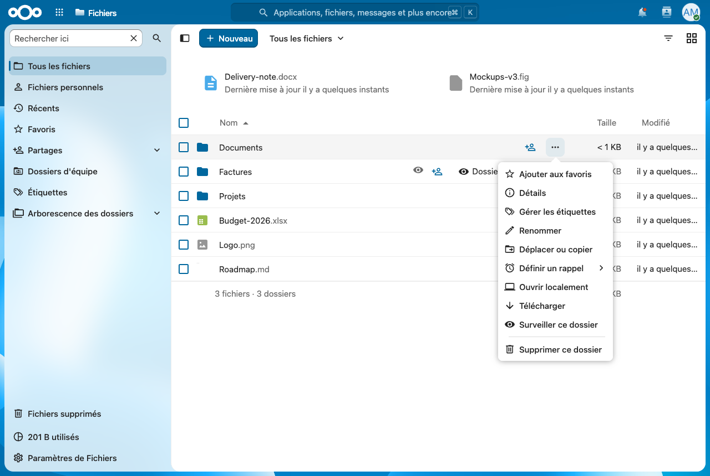
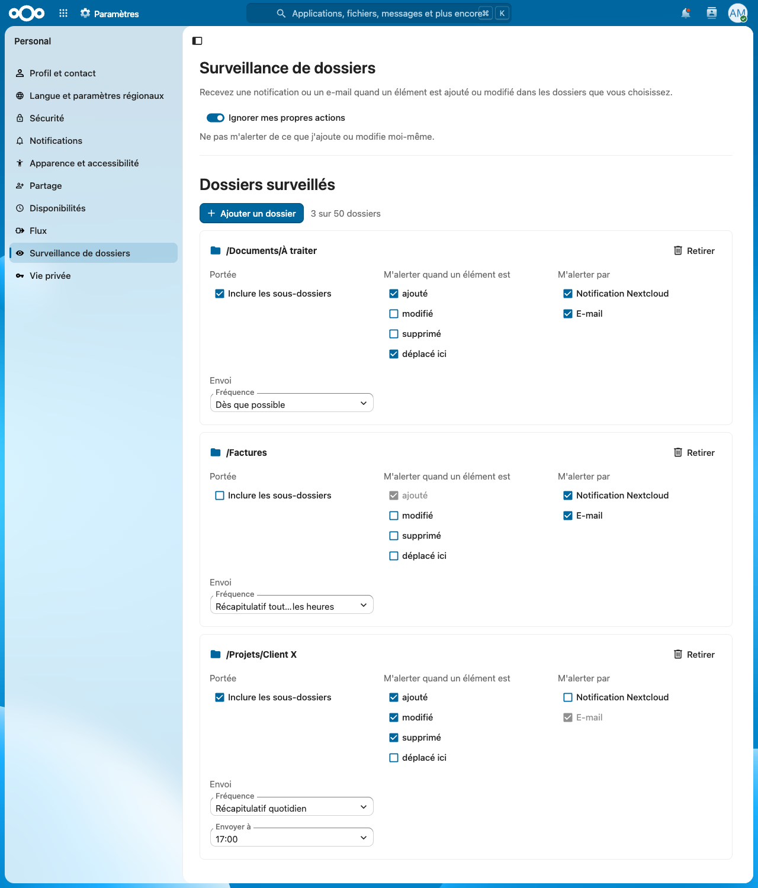
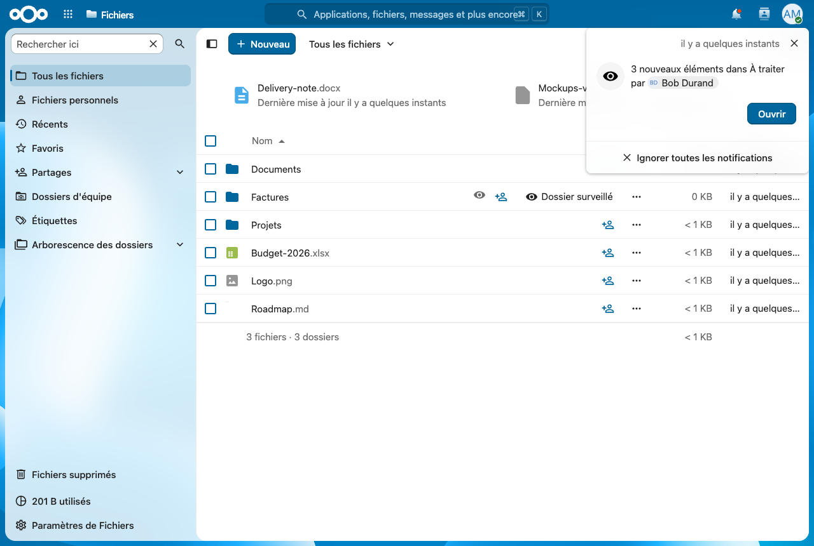
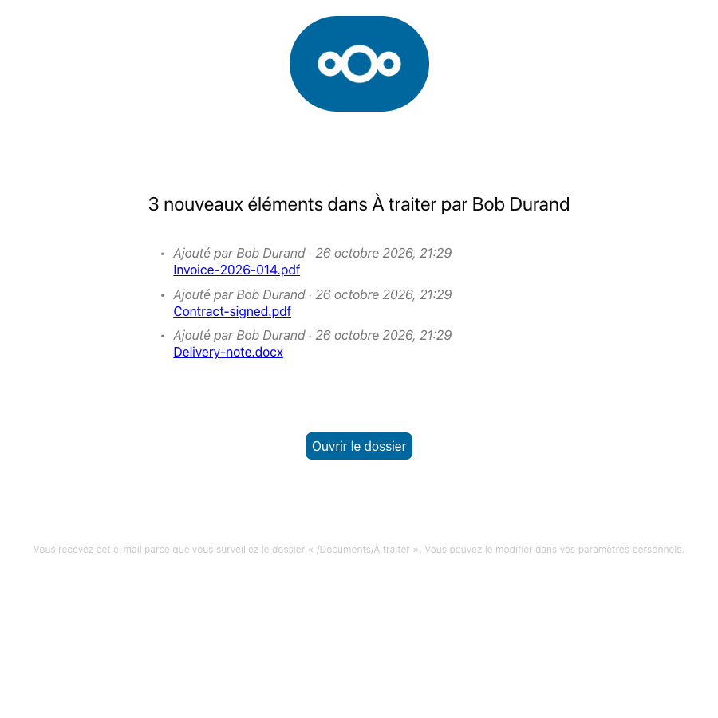

<!--
  - SPDX-FileCopyrightText: 2026 ZEDD
  - SPDX-License-Identifier: AGPL-3.0-or-later
-->

# Folder Watch — Surveillance de dossiers

Une application [Nextcloud](https://nextcloud.com) qui prévient chaque utilisateur quand un fichier ou un
sous-dossier est **ajouté, modifié, supprimé ou déplacé** dans les dossiers qu'il a choisi de surveiller :
par **notification Nextcloud**, par **e-mail**, ou les deux.

- id `folderwatch`, espace de noms `OCA\FolderWatch`, licence AGPL-3.0-or-later, éditeur ZEDD
- Nextcloud **33 à 36**, PHP **8.2+**, uniquement des API publiques (`OCP\`). Testé de bout en bout sur
  Nextcloud **35.0.2** et **33.0.10** (la 36 n'est pas encore sortie : la borne est déclarée, pas éprouvée) ;
  le code est vérifié syntaxiquement et par Psalm pour PHP 8.2, exécuté sous PHP 8.4 et 8.5
- interface en français et en anglais
- dépôt et suivi des problèmes : <https://github.com/feixeth/folderwatch>

| Dans Fichiers | Paramètres personnels |
|---|---|
|  |  |

| Notification | E-mail |
|---|---|
|  |  |

## Pourquoi

Les solutions existantes ne conviennent pas : *Flow Notifications + tags* est peu intuitif, n'envoie le mail
qu'indirectement et ne maîtrise pas son contenu ; *Mail Notifier* n'est plus maintenu ; *Webhook Listeners* est
une brique bas niveau sans interface. Folder Watch fait une seule chose, avec une interface pour les
utilisateurs, des réglages pour l'administrateur et des commandes `occ` pour la mise en place.

## Ce que voit l'utilisateur

**Choisir les dossiers.** Dans Fichiers, le menu d'un dossier propose « Surveiller ce dossier » / « Ne plus
surveiller » ; un œil marque les dossiers surveillés (un clic ouvre les réglages). Dans *Paramètres personnels →
Surveillance de dossiers*, on ajoute un dossier avec le sélecteur de fichiers et on règle, **pour chaque
dossier** :

| Réglage | Choix | Défaut |
|---|---|---|
| Sous-dossiers | inclus ou non | inclus |
| Événements | ajouté, modifié, supprimé, déplacé ici | ajouté + déplacé ici |
| Canal | notification, e-mail, ou les deux | les deux |
| Fréquence | dès que possible, récapitulatif horaire, récapitulatif quotidien (heure au choix) | dès que possible |

Une option globale « Ignorer mes propres actions » est activée par défaut. Les réglages s'enregistrent
immédiatement.

**Recevoir l'alerte.** Une notification et un e-mail **par dossier et par lot**, jamais un par fichier :

- « 3 nouveaux éléments dans À traiter par Alice », « Alice a ajouté rapport.pdf dans À traiter »,
  « 2 éléments supprimés de Factures par Bob »… avec le détail « 2 ajoutés, 1 modifié » quand le lot est mixte ;
- le bouton « Ouvrir » mène au fichier s'il est seul, au dossier sinon ;
- l'e-mail utilise le gabarit natif de Nextcloud (thème de l'instance), dans la langue de l'utilisateur :
  nom, auteur, date et lien de chaque élément, **50 au plus** puis « … et N autres éléments ».
  **Il ne contient jamais le contenu des fichiers**, seulement des noms et des liens qui demandent une
  authentification.
- sans adresse e-mail sur le compte, aucun mail n'est envoyé (trace en debug) et la notification part quand même ;
- **le canal e-mail est grisé, avec la raison**, dans les paramètres personnels quand il ne peut pas servir : coupé par
  l'administrateur, serveur e-mail de Nextcloud non configuré, ou pas d'adresse sur le compte. Et un bandeau
  « Les alertes peuvent arriver en retard » s'affiche quand les tâches de fond ne tournent pas par cron.

## Installation

### Depuis l'App Store

*Administration → Applications*, chercher « Folder Watch » (catégorie *Fichiers*), puis **Télécharger et activer**.
C'est la voie recommandée : l'archive est vérifiée (signature) et les mises à jour passent par Nextcloud.
(Tant que l'app n'est pas publiée sur l'App Store, utiliser l'installation manuelle.)

### Installation manuelle

1. Récupérer l'archive `folderwatch-<version>.tar.gz` (page des versions du dépôt, ou `make appstore`).
2. L'extraire dans le dossier des applications de l'instance (`apps/` ou `custom_apps/`, selon `apps_paths` dans
   `config.php`) **en tant qu'utilisateur PHP de l'instance**, puis activer l'app avec `occ` sous ce même
   utilisateur.

L'**utilisateur PHP** est celui qui exécute PHP pour Nextcloud et possède ses fichiers. Pour le connaître :

```bash
stat -c %U /chemin/vers/nextcloud/config/config.php      # Linux
```

C'est `www-data` sur une installation Debian ou Ubuntu standard, `apache` ou `nginx` ailleurs. **Sur un hébergement de
type Virtualmin ou ISPConfig, c'est l'utilisateur du site** (celui du domaine virtuel, par exemple `web1` ou le
nom du domaine), pas `www-data`. Avec cet utilisateur :

```bash
sudo -u <utilisateur> tar -xzf folderwatch-<version>.tar.gz -C /chemin/vers/nextcloud/custom_apps/
sudo -u <utilisateur> php /chemin/vers/nextcloud/occ app:enable folderwatch
```

Extraire directement sous cet utilisateur évite tout `chown` ; si l'archive a été extraite par `root`, rendre les
fichiers à l'utilisateur PHP (`chown -R <utilisateur>: …/folderwatch`) avant d'activer l'app. Si plusieurs versions de PHP
coexistent (cas courant sur ces hébergements), lancer `occ` avec le binaire PHP du site.

À l'activation, deux tâches de fond sont enregistrées : l'envoi des alertes (au plus une fois par minute) et le
nettoyage quotidien. En cas de mise à jour, `occ upgrade` applique les migrations de base de données.

### Ce que l'instance doit fournir

Trois points déterminent la fiabilité des alertes. Chacun est **vérifié et signalé** dans *Administration → Vue
d'ensemble* (trois contrôles « Folder Watch : … ») et, avec les mêmes messages, en tête de la page d'administration de
l'app :

| Point | Pourquoi | Sans lui |
|---|---|---|
| **Tâches de fond en mode `cron`** (`occ background:cron` et un cron système, au plus toutes les 5 minutes) | les alertes partent par un job | en mode AJAX ou webcron elles ne partent que lorsque quelqu'un visite le site : en retard, voire jamais. Les utilisateurs voient un bandeau « alertes possiblement retardées » |
| **Serveur e-mail de Nextcloud** configuré (*Paramètres de base → Serveur e-mail*) | le canal e-mail | pas d'e-mail : le canal est grisé pour les utilisateurs (raison affichée) et seules les notifications partent |
| **`overwrite.cli.url`** dans `config.php`, adresse publique de l'instance | liens des alertes construites **hors d'une requête web** (ligne de commande, cron, scan), et référence pour juger l'hôte des requêtes web | l'e-mail part **sans lien** et un avertissement est écrit dans le journal, au plus une fois par jour |

À propos des liens : ils ont la forme `/index.php/f/<identifiant du fichier>`, **sans chemin** : ils ouvrent le
fichier chez chaque destinataire, même s'il a renommé ou déplacé le dossier partagé de son côté. Ils sont **calculés
au moment de l'événement, dans la requête web qui l'a provoqué**, puis **conservés avec l'événement** : l'e-mail les
reprend tels quels, même si l'envoi a lieu plus tard par le cron. L'hôte de la requête n'est retenu que s'il est
fiable : celui de `overwrite.cli.url` quand il est utilisable (ni vide ni local), à défaut le premier des
`trusted_domains` (hors `localhost` et adresses de bouclage). Une requête arrivée par un autre nom (adresse interne,
ancien domaine, domaine secondaire) voit son lien reconstruit sur `overwrite.cli.url`. Les événements sans requête
web (ligne de commande, cron, scan) utilisent `overwrite.cli.url`. Sans adresse fiable, l'e-mail part sans lien
plutôt qu'avec un lien inutilisable. Les notifications Nextcloud calculent les leurs à l'affichage.

**Désinstallation.** `occ app:disable folderwatch` (réversible, les données restent) puis `occ app:remove
folderwatch`. Les trois tables (`oc_folderwatch_watches`, `_queue`, `_sends`) sont **conservées** : Nextcloud
exécute les étapes de désinstallation d'une app à chaque *désactivation*, donc un `DROP TABLE` effacerait tous les
réglages dès qu'un administrateur coupe l'app une minute. Pour les supprimer définitivement :
`DROP TABLE oc_folderwatch_queue, oc_folderwatch_sends, oc_folderwatch_watches;` puis
`DELETE FROM oc_migrations WHERE app = 'folderwatch';`.

## Réglages d'administration

*Paramètres d'administration → Surveillance de dossiers* (ou `occ config:app:set folderwatch …`) :

| Réglage | Clé | Défaut |
|---|---|---|
| Autoriser les alertes par e-mail | `mail_enabled` | oui |
| Dossiers surveillables par utilisateur (1 à 1000) | `max_watches_per_user` | 50 |
| Alertes par utilisateur et par heure (0 à 1000, 0 = illimité) | `max_sends_per_hour` | 20 |
| Noms de fichiers ignorés, un motif `fnmatch` par ligne | `ignored_patterns` | `*.part`, `.~lock.*`, `~$*`, `.DS_Store`, `Thumbs.db` |

Au-delà du plafond horaire, les alertes **attendent** dans la file et partent regroupées au prochain envoi
possible : rien n'est jeté. Les valeurs invalides sont refusées sans rien enregistrer.

## Commandes `occ`

```bash
occ folderwatch:list [--user=alice] [--output=json]        # tous les watches, état, éléments en attente
occ folderwatch:add alice /Documents/À\ traiter \
    [--no-recursive] [--channel=mail,notification] [--events=created,modified,deleted,moved_in] \
    [--frequency=immediate|hourly|daily] [--digest-hour=8]   # mise en place pour un client
occ folderwatch:remove 12                                   # par identifiant
occ folderwatch:flush                                       # envoie tout de suite, pratique pour tester
```

`flush` ignore la période de calme et les heures de récapitulatif, **pas** le plafond horaire de chaque
utilisateur. Une commande qui échoue rend un code de sortie non nul.

## API

OCS, authentifiée, toujours limitée à l'utilisateur courant (`/ocs/v2.php/apps/folderwatch/api/v1`) :

| Route | Rôle |
|---|---|
| `GET /watches` | liste |
| `POST /watches` | crée (`fileId` **ou** `path`, plus les réglages) |
| `GET /watches/status?fileId=` | ce dossier est-il surveillé ? |
| `PATCH /watches/{id}` | modifie |
| `DELETE /watches/{id}` | supprime |
| `GET/PUT /settings` | « ignorer mes actions » |
| `GET/PUT /admin/settings` | réglages d'instance, **administrateurs seulement** |

La spécification OpenAPI est dans `openapi.json` (et `openapi-administration.json`), générée par
`make openapi`.

## Comment ça marche

### Repérer les dossiers : par identifiant, jamais par chemin

Un chemin change selon le point de vue (propriétaire, destinataire d'un partage, dossier d'équipe) et à chaque
renommage ; un `file_id` non. Un watch est donc `(utilisateur, file_id)`.

À chaque `NodeCreatedEvent`, `NodeWrittenEvent`, `NodeRenamedEvent` ou `NodeDeletedEvent`, le listener
(`NodeEventsListener`) fait le minimum et **n'envoie rien** :

1. il ignore les chemins hors de `/<utilisateur>/files/…` (versions, corbeille, morceaux d'upload, `appdata_*`)
   et les noms exclus ;
2. il calcule la **chaîne des `file_id` ancêtres** du dossier parent en remontant la colonne `parent` du cache du
   stockage du nœud (`AncestorResolver`, API publique `ICache`). Cette remontée ne dépend pas de la vue :
   - un nœud atteint **par un partage** est relu depuis le **stockage du propriétaire**, dont le cache connaît
     toute l'arborescence au-dessus du point de partage. Un propriétaire qui surveille un dossier *au-dessus* du
     partage voit donc ce que fait le destinataire ;
   - les **dossiers d'équipe** (groupfolders) et les stockages externes n'ont pas de propriétaire : leur propre
     cache est remonté jusqu'à la racine du montage ;
3. une requête SQL retrouve les watches dont le `file_id` est le **dossier parent** (récursif ou non) ou l'un de
   ses **ancêtres** (récursif seulement) ;
4. pour chaque candidat : l'événement est-il souscrit ? l'acteur est-il le surveillant (option « ignorer mes
   actions ») ? le surveillant **voit-il encore** le dossier surveillé et le dossier concerné
   (`getUserFolder($uid)->getFirstNodeById()`) ? — ce qui couvre les partages retirés et les droits changés, et
   les ACL des dossiers d'équipe ;
5. les lignes sont **mises en mémoire puis écrites en un seul lot après la réponse** (INSERT multi-lignes), si bien
   qu'un dépôt de 500 fichiers ne ralentit pas la requête WebDAV (mesuré : aucune différence avec l'app désactivée).
   Les résultats coûteux (chaîne d'ancêtres, candidats, droits) sont mémorisés par dossier pour la requête.

Ce que Nextcloud émet réellement, observé sur la 35 : un nouveau fichier ou dossier (PUT, MKCOL, upload par
morceaux, copie) donne `Created` puis `Written` ; une réécriture, `Written` seul ; un déplacement ou renommage,
`Renamed` ; une suppression ou mise à la corbeille, `Deleted` ; une restauration de la corbeille, `Touched`.

Conséquences :

- `Created` + `Written` d'un même fichier = **un seul** « ajouté » ; un fichier créé puis supprimé dans la même
  requête ne laisse aucune trace ;
- un **déplacement entrant** compte comme un ajout (« déplacé ici », inclus par défaut) ; un déplacement à
  l'intérieur d'un arbre surveillé n'est **pas** une arrivée ; un **renommage dans le même dossier est ignoré** ;
  un déplacement **sortant** est signalé comme « supprimé » pour les watches qui s'y abonnent ;
- la restauration d'un élément depuis la corbeille ne déclenche pas d'alerte.

### Envoyer : un lot par dossier

Le job `SendAlertsJob` (au plus toutes les 60 s, donc à la cadence du cron) traite la file **par watch** :

- **Dès que possible** : on attend **2 minutes sans nouvel événement**, avec un plafond de **10 minutes** depuis le
  plus ancien, pour qu'un dépôt massif donne une seule alerte.
- **Récapitulatif horaire / quotidien** : envoi au passage de l'heure, ou de l'heure choisie dans le **fuseau de
  l'utilisateur** (changements d'heure compris).
- Les événements d'un même fichier sont fusionnés (créé puis modifié = ajouté ; créé puis supprimé = rien ;
  supprimé puis recréé = modifié).
- **Les accès sont revérifiés au moment de l'envoi** : dossier devenu inaccessible, fichier déjà supprimé…
- **Liens** : repris de ceux conservés avec les événements (voir Installation) ; une ligne sans lien (plus anciennes,
  ou événement hors requête web) reçoit celui que `overwrite.cli.url` permet, sinon l'e-mail part sans lien.
  Un Nextcloud qui ne peut pas envoyer d'e-mail (serveur non configuré) ne tente pas d'en envoyer : la notification part.
- Plafond horaire de l'administrateur, puis notification (`INotifier`) et e-mail (`IMailer` + `IEMailTemplate`).
  Si **tous** les canaux échouent, les lignes restent pour le prochain passage ; si un seul échoue, le lot est
  considéré comme envoyé (le canal perdu est journalisé) pour ne jamais créer de doublon.
- La file est purgée après envoi ; les lignes de plus de 7 jours le sont de toute façon.

### Nettoyer

- **Dossier à la corbeille** ou **partage retiré** : le watch est **suspendu** (aucune alerte) et **revit tout
  seul** à la restauration ou au partage retrouvé. Ce n'est pas détecté sur l'événement de suppression, qui est le
  même pour la corbeille et la suppression définitive, mais par le job `CleanupJob` (quotidien) et à l'envoi.
- **Supprimé pour de bon** (l'identifiant a disparu du cache de fichiers) : le watch est retiré après 24 h.
- **Inaccessible depuis 30 jours** (durée de rétention par défaut de la corbeille) : retiré.
- **Compte supprimé** (`UserDeletedEvent`) : watches, alertes en attente et journal d'envois disparaissent.

## Limites connues

- **Stockages externes modifiés hors de Nextcloud** (FTP, SMB, disque local) : aucun événement n'est émis tant
  qu'un `occ files:scan` n'a pas vu le changement, donc aucune alerte. Planifier ce scan pour les points de
  montage concernés ; une option d'administration qui le lancerait par les watches concernés n'est pas
  implémentée (les scans émettent d'autres événements, `NodeAddedToCache`, qui pourraient l'alimenter plus tard).
- **Un watch ne franchit pas un point de montage.** Surveiller un dossier qui *contient* un partage reçu, un
  dossier d'équipe ou un stockage externe ne remonte pas ce qui se passe dans ce montage : surveillez le dossier
  partagé lui-même. Surveiller le dossier partagé, la racine d'un dossier d'équipe, ou un dossier au-dessus du
  point de partage côté propriétaire fonctionne.
- **Les tâches de fond sont indispensables** (voir Installation).
- **Sans `overwrite.cli.url` utilisable**, les alertes provoquées hors d'une requête web (scan, ligne de commande)
  partent sans lien dans l'e-mail, et celles d'une requête web aussi si son hôte n'est pas le premier des
  `trusted_domains`.
- Les accès se vérifient au niveau du dossier : un droit retiré sur un fichier précis d'un dossier lisible n'est
  contrôlé qu'à l'envoi (le fichier doit être lisible pour apparaître).
- Les noms qui apparaissent dans un lot sont ceux de l'événement ; un fichier renommé avant l'envoi garde son nom
  d'origine dans le message (le lien, lui, suit le fichier).

## Développer

```bash
make dev            # Nextcloud + MariaDB + Mailpit + cron, http://localhost:8080 (admin/admin), Mailpit :8025
NC_VERSION=33 NC_PORT=8133 MAILPIT_PORT=8125 COMPOSE_PROJECT_NAME=fw33 make dev   # une autre version, à côté
make build          # frontend → js/ (Vue 3, @nextcloud/vue, Vite)
make test           # PHPUnit, vitest, PHPUnit dans le conteneur, parcours bout en bout
make check          # cs-fixer, Psalm, ESLint, vue-tsc, tests unitaires (sans l'instance de dev)
make appstore       # build/folderwatch-<version>.tar.gz
make help
```

| Outil | Ce qu'il vérifie |
|---|---|
| `tests/Unit` (PHPUnit) | matching, tampon, planification, agrégation, textes, envoi, nettoyage, commandes, `info.xml`, traductions |
| `tests/Integration` (PHPUnit **dans le conteneur**) | vrais utilisateurs, partages, groupfolders, corbeille, notifications rendues par le vrai `Notifier`, e-mails dans Mailpit |
| `tests/integration.sh` | le même parcours qu'un humain : WebDAV (`curl -T`), `occ`, API OCS des notifications, Mailpit |
| `tests-js` (vitest) | actions de Fichiers, paramètres personnels et d'administration |
| Psalm niveau 3, php-cs-fixer (`nextcloud/coding-standard`), ESLint (`@nextcloud/eslint-config`), `vue-tsc` | qualité statique |

Arborescence : `lib/Listener` (événements), `lib/Service` (matching, tampon, réglages, nettoyage), `lib/Alert`
(agrégation, planification, textes, canaux, envoi), `lib/Db` (entités et mappers), `lib/Controller` (OCS),
`lib/Command` (occ), `lib/Settings`, `src` (Vue 3), `l10n` (le JSON est la source, `python3 tools/gen_l10n.py` en
tire le `.js`), `tools` (données de démonstration et captures d'écran).

### Choix à connaître

- Défauts : « déplacé ici » est coché avec « ajouté », puisqu'un déplacement entrant est une création du point de
  vue du dossier.
- Pas d'étape de désinstallation qui supprime les tables (voir Désinstallation).
- Les entités marquent leurs champs à défaut dans le constructeur : le setter d'une entité Nextcloud ignore une
  valeur égale à celle de la propriété, et l'INSERT retomberait alors sur le défaut de la colonne.
- `#[\Override]` n'est pas utilisé (PHP 8.3) : l'app supporte PHP 8.2.

### Publier

`make appstore` construit l'archive (et refuse de le faire si `appinfo/info.xml` contient encore une URL
provisoire). Pour la publier sur l'App Store, la signer avec le certificat de développeur :

```bash
make appstore-sign KEY=~/.nextcloud/certificates/folderwatch.key CRT=~/.nextcloud/certificates/folderwatch.crt
```

## Licence

AGPL-3.0-or-later — © 2026 ZEDD.
