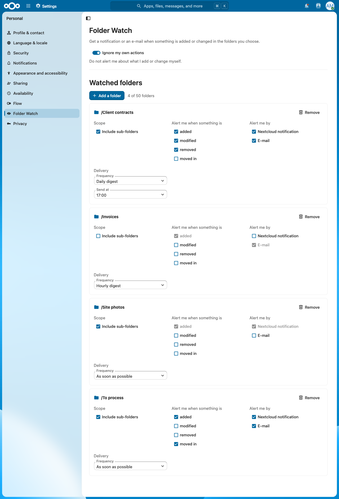
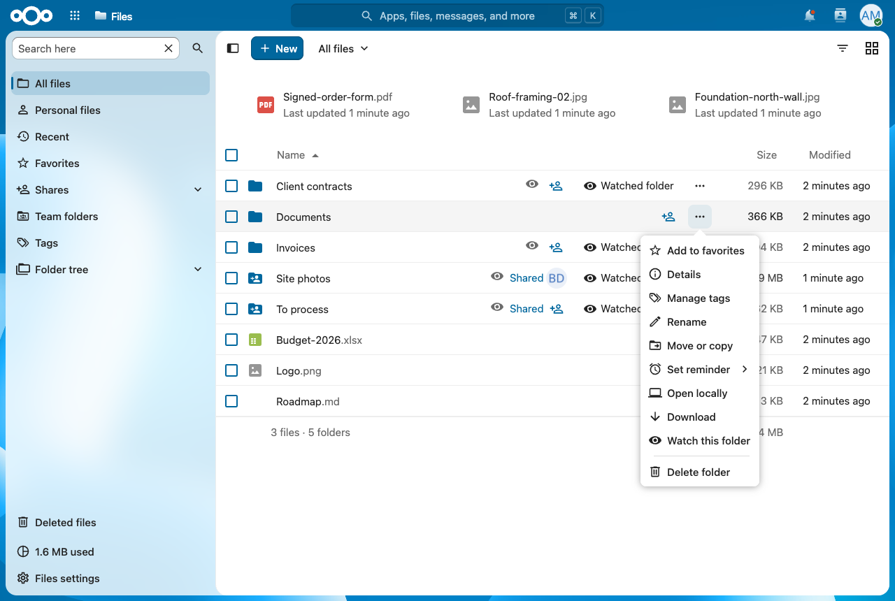
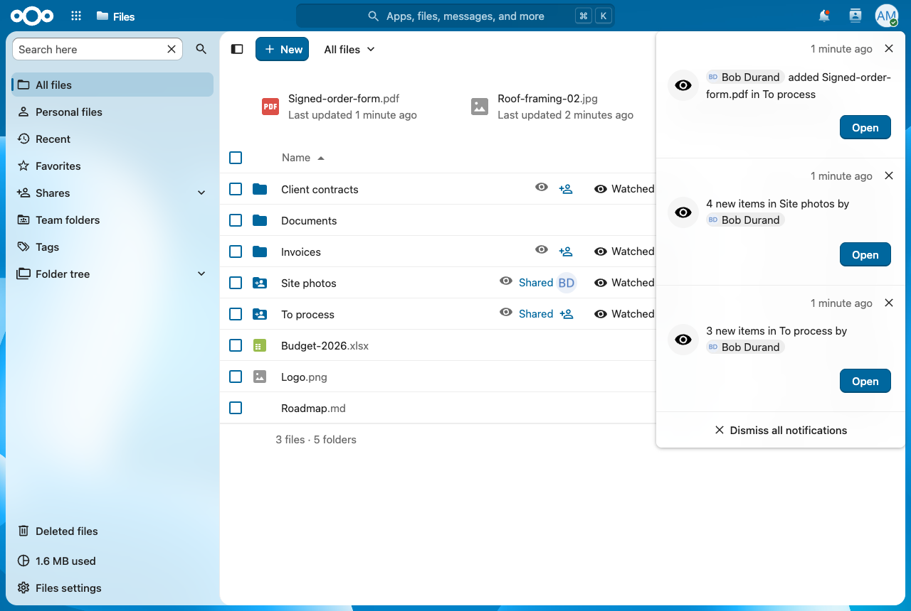
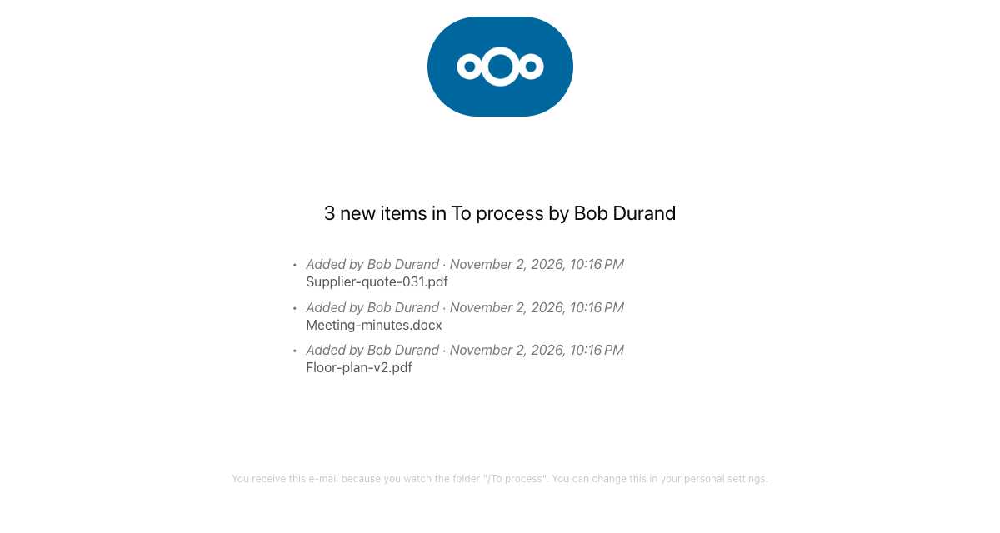
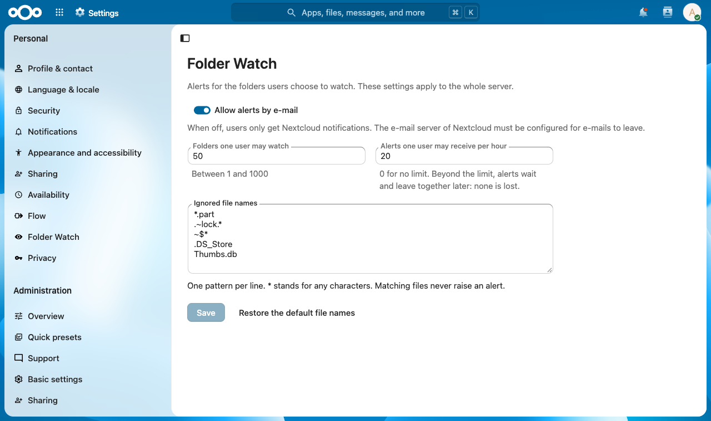

<!--
  - SPDX-FileCopyrightText: 2026 ZEDD
  - SPDX-License-Identifier: AGPL-3.0-or-later
-->

# Folder Watch

[Version française](README.fr.md)

A [Nextcloud](https://nextcloud.com) app that tells each user when a file or sub-folder is **added, modified,
removed or moved** into the folders they chose to watch: by **Nextcloud notification**, by **e-mail**, or both.

- id `folderwatch`, namespace `OCA\FolderWatch`, licence AGPL-3.0-or-later, publisher ZEDD
- Nextcloud **33 to 36**, PHP **8.2+**, public APIs only (`OCP\`). Tested end to end on Nextcloud **35.0.2** and
  **33.0.10** (36 is not released yet: the upper bound is declared, not proven); the code is checked by Psalm for
  PHP 8.2 and runs on PHP 8.4 and 8.5
- English and French interface
- source and issue tracker: <https://github.com/feixeth/folderwatch>

<p align="center">
  
</p>

| In Files | Grouped notification |
|---|---|
|  |  |

| E-mail | Administration |
|---|---|
|  |  |

## Why

The existing options do not fit: *Flow Notifications + tags* is not intuitive, sends the mail only indirectly and
gives no control over its content; *Mail Notifier* is no longer maintained; *Webhook Listeners* is a low-level
building block without an interface. Folder Watch does one thing, with an interface for users, settings for the
administrator and `occ` commands for set-up.

## What users see

**Choosing folders.** In Files, the menu of a folder offers "Watch this folder" / "Stop watching", and an eye marks
the watched folders (a click opens their settings). In *Personal settings → Folder Watch*, a folder is added with
the file picker and set up, **folder by folder**:

| Setting | Choices | Default |
|---|---|---|
| Sub-folders | included or not | included |
| Events | added, modified, removed, moved in | added + moved in |
| Channel | notification, e-mail, or both | both |
| Frequency | as soon as possible, hourly digest, daily digest (at the hour you pick) | as soon as possible |

A global "Ignore my own actions" option is on by default. Settings are saved as soon as they change.

**Receiving the alert.** One notification and one e-mail **per folder and per batch**, never one per file:

- "3 new items in To process by Alice", "Alice added report.pdf in To process", "2 items removed from Invoices by
  Bob"... with a detail line such as "2 added, 1 modified" when the batch is mixed;
- the "Open" button leads to the file when there is only one, to the folder otherwise;
- the e-mail uses the native Nextcloud template (the theme of the instance), in the language of the recipient: name,
  author, date and link of each item, **50 at most**, then "... and N more items". **It never contains file
  contents**, only names and links that require a login;
- an account without an e-mail address gets no mail (a debug trace is written) and the notification is sent anyway;
- **the e-mail channel is greyed out, with the reason**, in the personal settings when it cannot be used: switched off
  by the administrator, Nextcloud e-mail server not configured, or no address on the account. A banner "Alerts may
  arrive late" appears when background jobs do not run by cron.

## Installation

### From the App Store

*Administration → Apps*, search for "Folder Watch" (category *Files*), then **Download and enable**. This is the
recommended way: the archive is verified (signature) and updates come through Nextcloud. (Until the app is published
on the App Store, use the manual installation.)

### Manual installation

1. Get the archive `folderwatch-<version>.tar.gz` (the releases page of the repository, or `make appstore`).
2. Extract it into the apps folder of the instance (`apps/` or `custom_apps/`, according to `apps_paths` in
   `config.php`) **as the PHP user of the instance**, then enable the app with `occ` as that same user.

The **PHP user** is the one that runs PHP for Nextcloud and owns its files. To find it:

```bash
stat -c %U /path/to/nextcloud/config/config.php      # Linux
```

It is `www-data` on a standard Debian or Ubuntu installation, `apache` or `nginx` elsewhere. **On a Virtualmin or
ISPConfig hosting it is the site user** (the user of the virtual domain, for example `web1` or the domain name),
not `www-data`. With that user:

```bash
sudo -u <user> tar -xzf folderwatch-<version>.tar.gz -C /path/to/nextcloud/custom_apps/
sudo -u <user> php /path/to/nextcloud/occ app:enable folderwatch
```

Extracting directly as that user avoids any `chown`; if the archive was extracted by `root`, give the files back to
the PHP user (`chown -R <user>: …/folderwatch`) before enabling the app. If several PHP versions coexist (common on
such hostings), run `occ` with the PHP binary of the site.

Enabling the app registers two background jobs: sending alerts (at most once a minute) and a daily clean-up. When
updating, `occ upgrade` applies the database migrations.

### What the instance must provide

Three points decide how reliable the alerts are. Each one is **checked and reported** in *Administration → Overview*
(three "Folder Watch: …" checks) and, with the same messages, at the top of the administration page of the app:

| Point | Why | Without it |
|---|---|---|
| **Background jobs in `cron` mode** (`occ background:cron` and a system cron, every 5 minutes at most) | alerts are sent by a job | in AJAX or webcron mode they leave only when someone visits the site: late, or never. Users see an "alerts may arrive late" banner |
| **The Nextcloud e-mail server** configured (*Basic settings → Email server*) | the e-mail channel | no e-mail: the channel is greyed out for users (reason shown) and only notifications are sent |
| **`overwrite.cli.url`** in `config.php`, the public address of the instance | links of alerts built **outside a web request** (command line, cron, scan), and the reference to judge the host of web requests | the e-mail goes out **without a link** and a warning is written to the log, at most once a day |

About links: they have the form `/index.php/f/<file id>`, **with no path**: they open the file for every recipient,
even if they renamed or moved the shared folder on their side. They are **worked out when the event happens, in the
web request that caused it**, then **kept with the event**: the e-mail uses them as they are, even if it is sent
later by cron. The host of the request is kept only if it can be trusted: the host of `overwrite.cli.url` when that is
usable (neither empty nor local), otherwise the first of `trusted_domains` (except `localhost` and loopback
addresses). A request that came in through any other name (internal address, former domain, secondary domain) gets
its link rebuilt on `overwrite.cli.url`. Events without a web request (command line, cron, scan) use
`overwrite.cli.url`. With no trustworthy address, the e-mail goes out without a link rather than with a useless one.
Nextcloud notifications make their links when they are shown.

**Uninstalling.** `occ app:disable folderwatch` (reversible, the data stays), then `occ app:remove folderwatch`. The
three tables (`oc_folderwatch_watches`, `_queue`, `_sends`) are **kept**: Nextcloud runs the uninstall steps of an app
on every *disable*, so a `DROP TABLE` would erase every setting as soon as an administrator turns the app off for a
minute. To remove them for good:
`DROP TABLE oc_folderwatch_queue, oc_folderwatch_sends, oc_folderwatch_watches;` then
`DELETE FROM oc_migrations WHERE app = 'folderwatch';`.

## Administration settings

*Administration settings → Folder Watch* (or `occ config:app:set folderwatch …`):

| Setting | Key | Default |
|---|---|---|
| Allow alerts by e-mail | `mail_enabled` | yes |
| Folders one user may watch (1 to 1000) | `max_watches_per_user` | 50 |
| Alerts one user may receive per hour (0 to 1000, 0 = no limit) | `max_sends_per_hour` | 20 |
| Ignored file names, one `fnmatch` pattern per line | `ignored_patterns` | `*.part`, `.~lock.*`, `~$*`, `.DS_Store`, `Thumbs.db` |

Beyond the hourly limit, alerts **wait** in the queue and leave together at the next possible sending: nothing is
dropped. Invalid values are refused without saving anything.

## `occ` commands

```bash
occ folderwatch:list [--user=alice] [--output=json]        # all watches, state, pending items
occ folderwatch:add alice /Documents/To\ process \
    [--no-recursive] [--channel=mail,notification] [--events=created,modified,deleted,moved_in] \
    [--frequency=immediate|hourly|daily] [--digest-hour=8]   # set up for a user
occ folderwatch:remove 12                                   # by id
occ folderwatch:flush                                       # send now, handy to try a set-up
```

`flush` ignores the quiet period and the digest hours, **not** the hourly limit of each user. A command that fails
returns a non-zero exit code.

## API

OCS, authenticated, always limited to the current user (`/ocs/v2.php/apps/folderwatch/api/v1`):

| Route | Purpose |
|---|---|
| `GET /watches` | list |
| `POST /watches` | create (`fileId` **or** `path`, plus the settings) |
| `GET /watches/status?fileId=` | is this folder watched? |
| `PATCH /watches/{id}` | modify |
| `DELETE /watches/{id}` | delete |
| `GET/PUT /settings` | "ignore my own actions" |
| `GET/PUT /admin/settings` | instance settings, **administrators only** |

The OpenAPI specification is in `openapi.json` (and `openapi-administration.json`), generated by `make openapi`.

## How it works

### Finding folders: by id, never by path

A path changes with the point of view (owner, share recipient, team folder) and with every rename; a `file_id` does
not. A watch is therefore `(user, file_id)`.

On every `NodeCreatedEvent`, `NodeWrittenEvent`, `NodeRenamedEvent` or `NodeDeletedEvent`, the listener
(`NodeEventsListener`) does the minimum and **sends nothing**:

1. it ignores paths outside `/<user>/files/…` (versions, trash, upload chunks, `appdata_*`) and excluded names;
2. it works out the **chain of ancestor `file_id`s** of the parent folder by climbing the `parent` column of the cache
   of the storage of the node (`AncestorResolver`, public `ICache` API). The climb does not depend on the view:
   - a node reached **through a share** is read again from the **storage of the owner**, whose cache knows the whole
     tree above the share point. An owner who watches a folder *above* the share therefore sees what the recipient
     does;
   - **team folders** (groupfolders) and external storages have no owner: their own cache is climbed up to the root
     of the mount;
3. one SQL query finds the watches whose `file_id` is the **parent folder** (recursive or not) or one of its
   **ancestors** (recursive only);
4. for each candidate: is the event subscribed? is the actor the watcher (option "ignore my own actions")? does the
   watcher **still see** the watched folder and the folder concerned (`getUserFolder($uid)->getFirstNodeById()`)? This
   covers removed shares, changed rights and the ACLs of team folders;
5. the rows are **kept in memory and written in one batch after the response** (multi-row INSERT), so dropping 500
   files does not slow the WebDAV request down (measured: no difference with the app disabled). Costly results
   (ancestor chain, candidates, rights) are remembered per folder for the request.

What Nextcloud really emits, observed on 35: a new file or folder (PUT, MKCOL, chunked upload, copy) gives `Created`
then `Written`; a rewrite, `Written` alone; a move or rename, `Renamed`; a deletion or move to the trash, `Deleted`; a
restore from the trash, `Touched`.

Consequences:

- `Created` + `Written` of one file = **a single** "added"; a file created then deleted in the same request leaves no
  trace;
- a **move in** counts as an addition ("moved in", included by default); a move inside a watched tree is **not** an
  arrival; a **rename in the same folder is ignored**; a move **out** is reported as "removed" for the watches that
  subscribe to it;
- restoring an item from the trash raises no alert.

### Sending: one batch per folder

The `SendAlertsJob` job (every 60 s at most, so at the pace of cron) processes the queue **per watch**:

- **As soon as possible**: it waits for **2 minutes without a new event**, with a cap of **10 minutes** from the
  oldest, so that a mass drop gives a single alert.
- **Hourly / daily digest**: sent at the turn of the hour, or at the hour chosen, in the **time zone of the user**
  (daylight saving included).
- The events of one file are merged (created then modified = added; created then removed = nothing; removed then
  re-created = modified).
- **Access is checked again when sending**: folder no longer reachable, file already deleted...
- **Links**: taken from those kept with the events (see Installation); a line without a link (older ones, or an
  event outside a web request) gets the one `overwrite.cli.url` allows, otherwise the e-mail goes out without a link.
  A Nextcloud that cannot send e-mail (server not configured) does not try: the notification goes out.
- The hourly limit of the administrator, then the notification (`INotifier`) and the e-mail (`IMailer` +
  `IEMailTemplate`). If **all** channels fail, the rows stay for the next run; if only one fails, the batch is
  considered sent (the lost channel is logged) so that no duplicate is ever created.
- The queue is purged after sending; rows older than 7 days are purged anyway.

### Cleaning up

- **Folder in the trash** or **share removed**: the watch is **suspended** (no alert) and **comes back by itself** when
  the folder is restored or the share is back. This is not detected on the deletion event, which is the same for the
  trash and for permanent deletion, but by the `CleanupJob` job (daily) and when sending.
- **Deleted for good** (the id is gone from the file cache): the watch is removed after 24 h.
- **Unreachable for 30 days** (the default retention of the trash): removed.
- **Deleted account** (`UserDeletedEvent`): watches, pending alerts and the send log are removed.

## Known limitations

- **External storages changed outside Nextcloud** (FTP, SMB, local disk): no event is emitted until an
  `occ files:scan` has seen the change, so no alert. Schedule that scan for the mount points concerned; an
  administration option that would run it for the watches concerned is not implemented (scans emit other events,
  `NodeAddedToCache`, which could feed it later).
- **A watch does not cross a mount point.** Watching a folder that *contains* a received share, a team folder or an
  external storage does not report what happens inside that mount: watch the shared folder itself. Watching the
  shared folder, the root of a team folder, or a folder above the share point on the owner's side works.
- **Background jobs are essential** (see Installation).
- **Without a usable `overwrite.cli.url`**, alerts raised outside a web request (scan, command line) go out without a
  link in the e-mail, and so do those of a web request whose host is not the first of `trusted_domains`.
- Access is checked at folder level: a right removed on a specific file of a readable folder is only checked at
  sending time (the file must be readable to appear).
- The names that appear in a batch are those of the event; a file renamed before sending keeps its original name in
  the message (the link, however, follows the file).

## Development

```bash
make dev            # Nextcloud + MariaDB + Mailpit + cron, http://localhost:8080 (admin/admin), Mailpit :8025
NC_VERSION=33 NC_PORT=8133 MAILPIT_PORT=8125 COMPOSE_PROJECT_NAME=fw33 make dev   # another version, side by side
make build          # frontend → js/ (Vue 3, @nextcloud/vue, Vite)
make test           # PHPUnit, vitest, PHPUnit in the container, end-to-end run
make check          # cs-fixer, Psalm, ESLint, vue-tsc, unit tests (without the dev instance)
make appstore       # build/folderwatch-<version>.tar.gz
make help
```

| Tool | What it checks |
|---|---|
| `tests/Unit` (PHPUnit) | matching, buffer, scheduling, aggregation, texts, sending, clean-up, commands, `info.xml`, translations |
| `tests/Integration` (PHPUnit **in the container**) | real users, shares, groupfolders, trash, notifications rendered by the real `Notifier`, e-mails in Mailpit |
| `tests/integration.sh` | the same run as a human: WebDAV (`curl -T`), `occ`, the OCS notifications API, Mailpit |
| `tests-js` (vitest) | Files actions, personal and administration settings |
| Psalm level 3, php-cs-fixer (`nextcloud/coding-standard`), ESLint (`@nextcloud/eslint-config`), `vue-tsc` | static quality |

Layout: `lib/Listener` (events), `lib/Service` (matching, buffer, settings, clean-up), `lib/Alert` (aggregation,
scheduling, texts, channels, sending), `lib/Db` (entities and mappers), `lib/Controller` (OCS), `lib/Command` (occ),
`lib/Settings`, `src` (Vue 3), `l10n` (the JSON is the source, `python3 tools/gen_l10n.py` derives the `.js`), `tools`
(demo data and screenshots).

The screenshots of this page and of the App Store listing are regenerated with `tools/seed-demo.sh fr|en` then
`node tools/screenshots.mjs fr|en`.

### Choices worth knowing

- Defaults: "moved in" is ticked along with "added", since a move in is a creation from the point of view of the
  folder.
- No uninstall step that deletes the tables (see Uninstalling).
- Entities mark their default fields in the constructor: the setter of a Nextcloud entity ignores a value equal to
  the one of the property, and the INSERT would then fall back on the default of the column.
- `#[\Override]` is not used (PHP 8.3): the app supports PHP 8.2.
- Labels of the frequency selector are kept short (24 characters at most): the selector is only as wide as a column
  of the settings page, and a long label ends in an ellipsis on a phone. A unit test guards it.

### Publishing

`make appstore` builds the archive. To publish it on the App Store, sign it with the developer certificate:

```bash
make appstore-sign KEY=~/.nextcloud/certificates/folderwatch.key CRT=~/.nextcloud/certificates/folderwatch.crt
```

## Licence

AGPL-3.0-or-later — © 2026 ZEDD.
